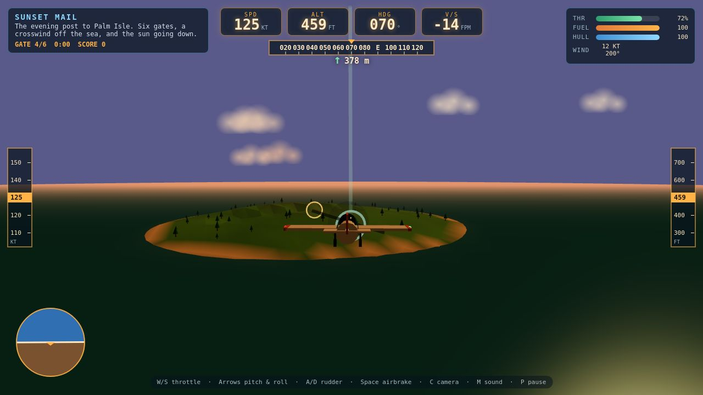

# Tradewind Courier — Island Air Mail

Fly a little mail plane between tropical islands: thread glowing gates, watch your fuel, and put her down soft on the runway. Built for the [best flight game](https://make.fun/bounty/best-flight-game-20261126-0057) bounty on make.fun.

## The game

Five named missions plus Free Flight, across three islands and two runways:

- **First Flight** — 4 gates, calm air, learn the plane.
- **Sunset Mail** — 6 gates at dusk, 12 kt crosswind.
- **Storm Runner** — 8 gates in rain, 25 kt gusts.
- **Island Hop** — two landings, out and back, with refuel.
- **Night Owl** — 7 gates at night, lit runway.
- **Free Flight** — no gates, no clock, just fly.

Score: gate ×100 + soft-landing bonus (up to 500) + time bonus + fuel bonus. Gold, silver and bronze medals per mission; best scores saved locally.

Arcade flight model with stall below 26 m/s, rotation at 30 m/s, fuel warnings and engine-out, hull damage from hard landings, airbrake, wind and gusts per mission. Full HUD: speed, altitude, heading, vertical speed, artificial horizon, speed/altitude tapes, compass strip, gate counter, timer, score, throttle / fuel / hull bars, wind, and a next-gate arrow with distance. All sound is synthesized WebAudio — no audio files.

## Controls

| Key | Action |
| --- | ------ |
| W / S | Throttle up / down |
| Arrow keys | Pitch & roll |
| A / D | Rudder |
| Space | Airbrake |
| C | Camera (chase / cockpit) |
| P / Esc | Pause |
| R | Restart |
| M | Mute |
| Mouse drag | Steer |

## Play it

No build step, no network. Open `game/index.html` in desktop Chrome (or serve the `game/` folder with any static HTTP server) and fly.

## Tech

Three.js r160, vendored under `game/vendor/`. Everything else is hand-written: `game/src/` holds the world, physics, aircraft, missions, HUD, audio, input and rendering. The entry point `main.ts` assembles the hand-in (dossier + game + screenshots).

## License

MIT — see [LICENSE](LICENSE).
